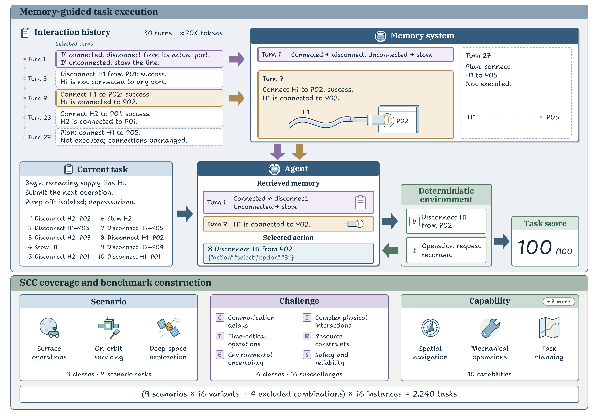

# AstroMemBench

**面向具身智能航天器的记忆系统测试基准。**

[English](README.md#english) · **简体中文** · [快速开始](docs/quickstart.md#简体中文) · [适配器指南](docs/adapters.md#简体中文) · [题库说明](docs/dataset.md#简体中文) · [版本下载](https://github.com/flyingView/AstroMemBench-v1/releases)

AstroMemBench 是专为具身智能航天器设计的记忆系统测试基准，面向长周期自主运行，考察记忆能否帮助智能体持续遵守任务要求、准确维护物理状态、修订既有经验，并将历史知识转化为正确、安全、节约资源的行动。

基准采用场景—挑战—技能（Scenario–Challenge–Capability，SCC）三维设计框架，将六类航天运行挑战细化为 16 项记忆子挑战，关联九项场景任务与十项技能标签。140 个模板、2,240 道固定测试题覆盖星表作业、在轨服务与深空探索，具体包括区域勘察、定点采样、物资转运、目标巡检、设备维修、在轨补给、巡航保障、科学观测和数据回传。

题目围绕通信时延、时间关键操作、环境不确定性、复杂物理交互、资源约束，以及安全与可靠性展开。每题先提供 30 轮交互历史，再让智能体在确定性环境中执行动作，按照任务完成情况、物理状态、安全约束和资源消耗评分，让记忆的价值直接体现在执行后果上。同会话与新会话两种条件用于检验跨会话边界的记忆表现，JSONL 适配器则支持接入用户自己的智能体、模型或记忆系统，共同为航天记忆系统的设计与比较提供统一的任务级检验。

如果你的记忆系统面向航天具身智能任务设计，并已通过经典通用基准的广泛检验，可以来到 AstroMemBench，进行更垂直、更专业的测试——然后，准备远征太空！



*图中的任务与分数用于说明评测流程，不是实际实验成绩。*

## 提供什么

| 内容 | 范围 |
| --- | --- |
| 固定题库 | 140 个任务模板，共 2,240 题 |
| 覆盖范围 | 6 类挑战、16 个子挑战、9 类任务场景、10 个能力标签 |
| 历史输入 | 每题 30 轮，包含任务相关记录与背景记录 |
| 会话条件 | 历史后继续原会话 `same_session`，或切换新会话 `new_session` |
| 评测工具 | 任务环境、动作校验、结果评分与本地汇总 |
| 接入方式 | 不限定编程语言的 JSONL 进程协议，以及可直接运行的随机动作示例 |
| 实验工作台 | 分组设计、独立后台执行、暂停恢复、分类结果、配对比较与导出 |

题目以中文为主，部分包含图片。基准负责维护任务环境和评分，适配器及被测系统负责推理、会话状态与记忆。

## 快速开始

从 [v1.0.0 Release](https://github.com/flyingView/AstroMemBench-v1/releases/tag/v1.0.0) 下载 **[astromembench-1.0.0.zip](https://github.com/flyingView/AstroMemBench-v1/releases/download/v1.0.0/astromembench-1.0.0.zip)**。完整包已包含代码、教程、示例适配器和全部题库。

安装 Python 3.11 或更高版本后，执行以下命令。如果系统只有 `python3` 命令，请在激活虚拟环境前用它代替 `python`：

```bash
python -m zipfile -e astromembench-1.0.0.zip .
cd astromembench-1.0.0
python -m venv .venv
```

Windows PowerShell 运行 `.\.venv\Scripts\Activate.ps1`，Linux/macOS 运行 `source .venv/bin/activate`，激活环境后继续：

```bash
python -m pip install -e .
astromembench validate --data data/benchmark
astromembench run --data data/benchmark --adapter examples/random-adapter.json --output runs/quickstart --case FM-C1-P1-001 --mode same_session
astromembench summarize runs/quickstart
```

安装问题见[安装指南](docs/installation.md#简体中文)。需要用 Git 开发时，也可以[克隆代码并单独下载题库](docs/installation.md#下载题库)。

这次单题运行检查安装、适配器通信和结果输出，不需要密钥或模型服务。示例随机选择动作，得分仅用于检查流程。

安装后，运行 `python scripts/start_webui.py` 即可打开浏览器界面，启动器会自动选择空闲的本地端口。Windows 用户也可以双击 **Start AstroMemBench.cmd**。导入适配器后，即可设计实验分组并检查结果。关闭界面后后台实验继续运行，重开相同工作目录即可暂停、停止或恢复。详见[工作台指南](docs/workbench.md#简体中文)。

## 评测自己的系统

适配器需要处理六个操作：`reset`、`new_session`、`history`、`observe`、`feedback`、`end`。评测器启动适配器进程，每行发送一个 JSON 请求，收到回复后再发送下一条。[适配器指南](docs/adapters.md#简体中文) 说明了消息格式、动作提交、图片输入和会话切换规则。

先用单题检查交互记录，再使用自己的适配器配置运行完整题库：

```bash
astromembench run --data data/benchmark --adapter my-adapter.json --output runs/my-system --mode new_session
astromembench summarize runs/my-system
```

未指定 `--case` 时运行全部 2,240 题，使用发布题库中的完整历史。模型服务和记忆系统由适配器自行接入和配置。

## 使用指南

| 指南 | 内容 |
| --- | --- |
| [安装](docs/installation.md#简体中文) | Python 环境、题库下载与常见问题 |
| [快速开始](docs/quickstart.md#简体中文) | 首次运行、筛选题目与查看基准 |
| [适配器](docs/adapters.md#简体中文) | JSONL 接入协议完整说明 |
| [评测](docs/evaluation.md#简体中文) | 会话模式、评分、输出与恢复运行 |
| [工作台](docs/workbench.md#简体中文) | 分组设计、后台执行、结果查询、比较、导出与接口约定 |
| [题库](docs/dataset.md#简体中文) | 任务覆盖、记录结构、图片与完整性校验 |

## 许可证

源代码、自编题目内容和合成历史采用 [MIT 许可证](LICENSE)。第三方图片保留原有许可条款，来源说明见[题库指南](docs/dataset.md#许可证与图片署名)。

Research Group on Intelligent Technologies for Spacecraft, Zhejiang University · you wu
